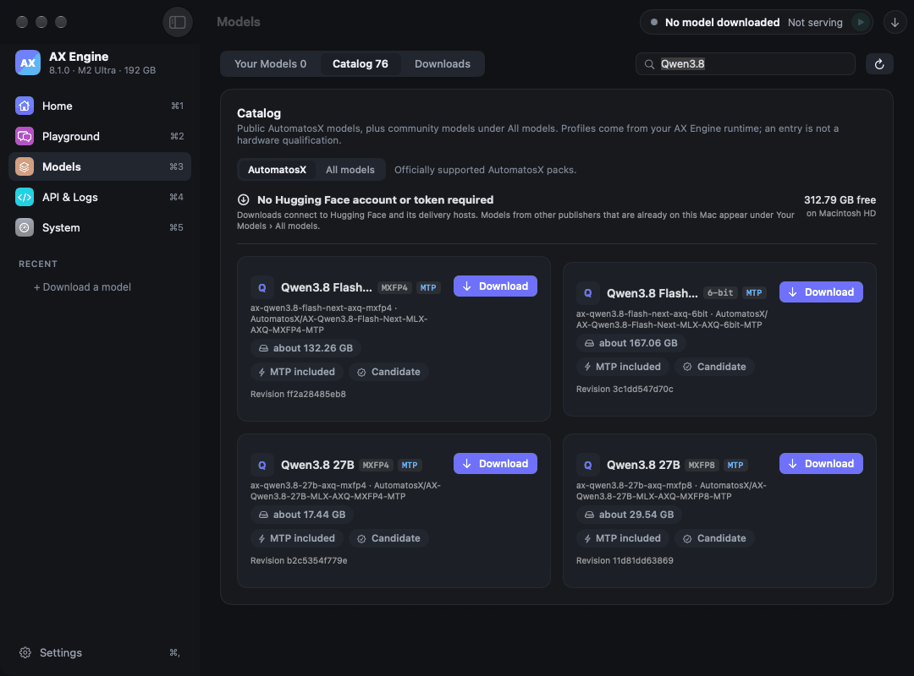
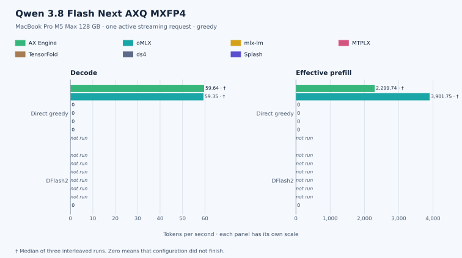
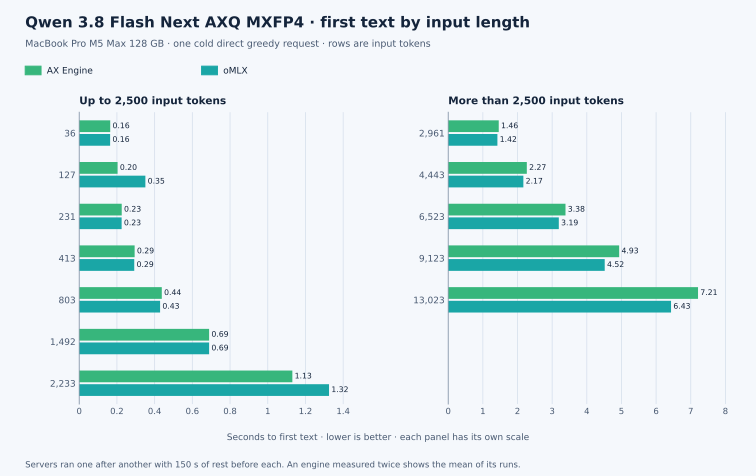
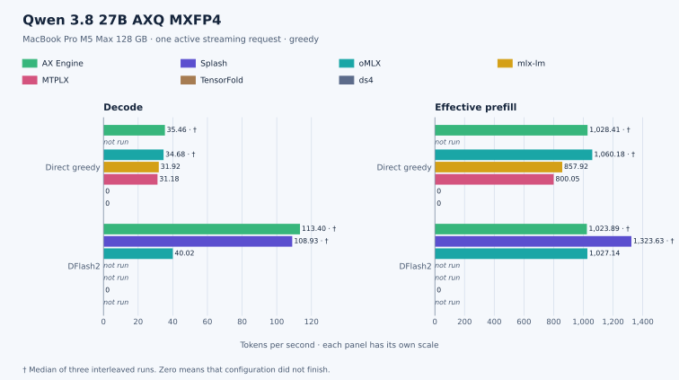
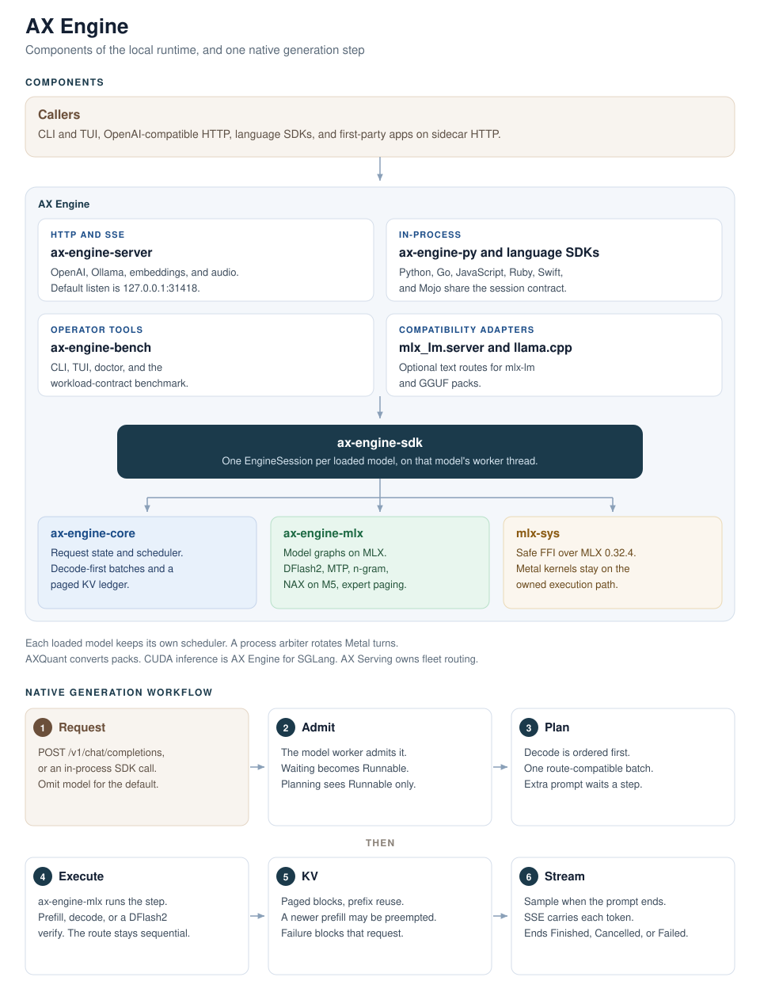

<div align="center">


# AX Engine

[](https://github.com/defai-digital/ax-engine/actions/workflows/ci.yml)
[](https://pypi.org/project/ax-engine/)
[](#install-ax-engine-for-macos)
[](docs/MLX-BACKEND.md)
[](LICENSE)

</div>

AX Engine runs AI models locally on Apple Silicon with MLX. Use the macOS app
to download models, chat, and serve models through an OpenAI-compatible API.

[Install for macOS](#install-ax-engine-for-macos) · [Supported models](#models) · [Performance](#performance) · [Documentation](docs/README.md)

<picture>
  <source media="(prefers-reduced-motion: reduce)" srcset="docs/images/ax-engine-macos-catalog.png">
  
</picture>

## Performance

Results are grouped by machine, then by model: Qwen 3.8 Flash Next,
then Qwen 3.8 27B. Both published packs here are AXQ MXFP4.

### MacBook Pro M5 Max 128 GB

**Qwen 3.8 AXQ MXFP4 · One active request.**
Each model uses a pinned pack and the same requests across engines.
The 27B DFlash2 rows use identical drafter weights.

**Decode** measures visible output after the first SSE text chunk.
**Effective prefill** is the slope between the first-text latencies of a
short and a long input, so it moves when either probe moves; the two
latencies are listed beside it. A zero means the tested configuration did
not complete the workload.

On Flash Next, decode is level with oMLX; first text is ahead at 127 to
128 and at 2,233 input tokens, level at 1,492, and 2 to 11% behind from
about 3,000 to 13,000 tokens. On the 27B, AX Engine's DFlash2 decode is
ahead of Splash on this 64-token harness (111.0 against 109.2 tok/s) and
behind it on prefill (first text 1.69 against 1.22 s at 1,492 input
tokens) and on 256-token outputs.
[What changed and what is left](docs/performance/qwen38-m5-tree-verify-and-flash-next-2026-11-25.md) ·
[Flash Next first text by prompt length](docs/performance/flash-next-qsa-masked-dense-2026-11-25.md).

<!-- qwen38-m5-modes:begin -->

#### Qwen 3.8 Flash Next MXFP4



| Engine and mode | Decode (output tok/s) | Effective prefill (input tok/s) | First text, 127–128 input tokens (s) | First text, 1,492 input tokens (s) |
| --- | ---: | ---: | ---: | ---: |
| AX Engine 8.1.0+071e5477 (Direct greedy) † | 59.36 | 2837.63 | 0.22 | 0.70 |
| oMLX 0.8.2 (Direct greedy) † | 59.39 | 4016.76 | 0.36 | 0.71 |
| mlx-lm 0.32.0 (Direct greedy) | 0 | 0 | — | — |
| MTPLX 2.12.3 (Direct greedy) | 0 | 0 | — | — |
| TensorFold 1.3.4 (Direct greedy) | 0 | 0 | — | — |
| ds4 19b3f501 (Direct greedy) | 0 | 0 | — | — |
| Splash 1.7.0 (DFlash2) | 0 | 0 | — | — |

† Median of three runs interleaved with the neighbouring † rows in one later session on the same day; the other rows are single runs from the original session. See the [campaign notes](benchmarks/results/qwen38-m5-modes-20261125/README.md#paired-rerun).

**First text by input length**, one cold direct greedy request. The servers ran one after another in the order AX Engine, oMLX, AX Engine, with 150 seconds of rest before each; the AX Engine column is the mean of its two runs. Lower is better. [Measurements and method](docs/performance/flash-next-qsa-masked-dense-2026-11-25.md).



| Input tokens | AX Engine 8.1.0+c688907a (s) | oMLX 0.8.2 (s) | AX Engine against oMLX |
| ---: | ---: | ---: | ---: |
| 36 | 0.174 | 0.164 | +6% |
| 127 | 0.215 | 0.349 | −38% |
| 231 | 0.236 | 0.225 | +5% |
| 413 | 0.306 | 0.291 | +5% |
| 803 | 0.450 | 0.441 | +2% |
| 1,492 | 0.706 | 0.698 | +1% |
| 2,233 | 1.174 | 1.335 | −12% |
| 2,961 | 1.462 | 1.437 | +2% |
| 4,443 | 2.284 | 2.195 | +4% |
| 6,523 | 3.408 | 3.218 | +6% |
| 9,123 | 4.970 | 4.574 | +9% |
| 13,023 | 7.281 | 6.573 | +11% |

#### Qwen 3.8 27B MXFP4



| Engine and mode | Decode (output tok/s) | Effective prefill (input tok/s) | First text, 127–128 input tokens (s) | First text, 1,492 input tokens (s) |
| --- | ---: | ---: | ---: | ---: |
| AX Engine 8.1.0+071e5477 (Direct greedy) † | 35.30 | 971.16 | 0.23 | 1.63 |
| AX Engine 8.1.0+071e5477 (DFlash2) † | 111.00 | 935.61 | 0.23 | 1.69 |
| Splash 1.7.0 (DFlash2) † | 109.16 | 1285.85 | 0.17 | 1.22 |
| oMLX 0.8.2 (Direct greedy) † | 34.49 | 1057.93 | 0.22 | 1.51 |
| oMLX 0.8.2 (DFlash2) | 40.02 | 1027.14 | 0.30 | 1.65 |
| mlx-lm 0.32.0 (Direct greedy) | 31.92 | 857.92 | 0.24 | 1.83 |
| MTPLX 2.12.3 (Direct greedy) | 31.18 | 800.05 | 0.24 | 1.94 |
| TensorFold 1.3.4 (Direct greedy) | 0 | 0 | — | — |
| TensorFold 1.3.4 (DFlash2) | 0 | 0 | — | — |
| ds4 19b3f501 (Direct greedy) | 0 | 0 | — | — |

† Median of three runs interleaved with the neighbouring † rows in one later session on the same day; the other rows are single runs from the original session. See the [campaign notes](benchmarks/results/qwen38-m5-modes-20261125/README.md#paired-rerun).

<!-- qwen38-m5-modes:end -->

[Raw results, route checks and reproduction](benchmarks/results/qwen38-m5-modes-20261125/README.md) ·
[AX concurrency, verifier and startup controls](#ax-runtime-controls)

## Hardware and model fit

**Prebuilt packages require macOS 26.2 or later on Apple Silicon.** Hardware tiers:

| Tier | Chips | What to expect |
| --- | --- | --- |
| Primary | **M5 and later** | Defaults, tuning and published performance are measured here. Best experience. |
| Supported | M3, M4 | Tested for correctness every release; may be slower than M5. |
| Best-effort | M2 | Runs, but is not tuned or qualified. |
| Not supported | M1 | Startup fails closed. |

Product SKUs:

- **Qwen 3.8 27B AXQ (`qwen3.8-27b:axq`)** — optimized on M5-class Macs (32 GB+ recommended). The 2026-11-18 product-health gate passed on MacBook Pro M5 Max 128 GB. The earlier published qualification record is the retired 6-bit pack on a Mac mini M4 Pro 64 GB, a supported M4-tier configuration. MXFP4 SKU qualification and MTP Tier 2 remain pending
- **Qwen 3.8 Flash Next MXFP4 MTP** (125B-A6B). Second SKU. Qualification and certification standard: MacBook Pro M5 Max 128 GB, single-stream resident (one request at a time, MTP off, contexts up to 32k). MXFP4 MTP target. The signed v7.9.0 release passed the direct-default gates on this standard. AX certification record: Candidate. Model MTP remains an experimental opt-in; MTP Tier 2 is pending.
  `qwen3.8-flash-next:axq` and `qwen3.8-flash-next:mxfp4` select the pinned
  MXFP4 MTP pack. Launching this pack on the standard host defaults to one
  engine job and a 32,768-token context budget, including output tokens.
  A signed v8.1.0 candidate reached HTTP readiness in **28–30 seconds**
  with automatic buffered reads on the eligible internal SSD.
  [Flash Next operating profile](docs/model-certifications/qwen3.8-flash-next.md#current-mxfp4-evidence).
- **Mac Studio, Ultra-class Apple Silicon with 192 GB+ RAM** (M3 Ultra or newer; M2 Ultra is best-effort) — larger-memory host for the same Flash Next pack.
  The 2026-10-05 direct-default release gates were measured here and stay bound to this host.

Compact single models (Qwen 3.5 9B 4-bit preferred) still fit **16 GB**. Prefer
4-bit for headroom on that class.

Wired-memory controls are available on every Mac AX Engine runs on (M2 and
newer); they are not M5-only. The automatic **no-wire optimization** currently targets only
the two audited Tiel MXFP4 MTP exports on **M5 Max with at least 128 GiB**.
Other supported hosts retain existing wiring. Model fit and measured speed
still depend on memory capacity and workload; see the
[Tiel residency policy](docs/mtp/tiel-prefill-diagnostics.md#residency-policy-for-the-audited-m5-max-exports).

## Why AX Engine

- **MLX-backed AXQ MX packs** — `qwen3.8-27b:axq` selects the pinned
  MXFP4 MTP pack. `qwen3.8-27b:mxfp8` selects the pinned MXFP8 MTP Candidate.
  Flash Next has its own `qwen4_exp` route and MXFP4 MTP selector. See the
  [format and migration policy](docs/QWEN38-FORMAT-POLICY.md).
- **DFlash2 on eligible greedy Qwen text** — Qwen 3.8 27B and Qwen 3.6
  35B-A3B draft a block with DFlash2 when the matching Apache-2.0 checkpoint
  is already on disk (`z-lab/Qwen3.8-27B-DFlash2`,
  `incoai/Qwen3.6-35B-A3B-DFlash2`). The server does not download it, and it
  is not inside the AXQ pack. Sampled requests, grammars, images, and a
  missing checkpoint stay on the normal routes. MTP stays explicit opt-in.
  See [DFlash2](docs/mtp/README.md#dflash2).
- **NAX attention on M5** — on M5 or later with macOS 26.2 or newer, MLX
  selects Neural Accelerator GEMM and SDPA. AX keeps native causal attention
  for allowlisted full-attention prefill of at least 1024 tokens, including
  Qwen 3.8 27B. Gemma stays off that policy. M3 and M4 do not arm it.
  `AX_MLX_NAX_ATTENTION=0` turns the attention policy off. See
  [NAX attention](docs/MLX-BACKEND.md#nax-attention).
- **Multi-model in one process** — keep allowlisted Qwen 3.5/3.6,
  Qwen 3.8 27B MXFP4, Qwen3-Coder-Next, Gemma 4 and embedding models
  resident (`load_mode=add`). Route chat and embeddings by request `model`.
  [Multi-model serving](docs/SERVER.md#multi-model-serving).
- **You own the stack you serve** — AX runs the MLX graph, KV/runtime, and
  OpenAI-compatible server for supported Gemma / Qwen / GLM (and other direct
  families); `mlx-lm` and `llama.cpp` stay optional compatibility adapters
- **Engine-owned scheduling and KV** — continuous batched decode
  (certification-gated), chunked prefill, preempt-and-recompute, and a paged
  KV ledger with cross-request prefix sharing run inside the engine, with a
  published `ax_runtime_*` saturation contract for fleet routers — see
  [Scheduling and KV runtime](#scheduling-and-kv-runtime)
- **Native media and speech** — image/video chat, mixed image+audio reasoning,
  OCR, and Whisper transcription/translation run through repo-owned MLX graphs
  with capability-gated OpenAI endpoints (checkpoint-authoritative; see media
  table below)
- **Clear fleet boundary** — AX Engine owns local Apple Silicon inference.
  [AX Engine for SGLang](https://github.com/defai-digital/ax-engine-sglang#quick-start)
  owns Linux CUDA inference.
  [AX Serving](docs/AX-SERVING.md) owns fleet orchestration.
- **Claims you can audit** — public rows ship with checked-in artifacts (route,
  model snapshot, sampler, accept rate, provenance)

## Components and workflow



Clients enter through the HTTP server, the Python binding, or a language SDK.
`ax-engine-sdk` keeps one session per loaded model on that model's worker
thread. `ax-engine-core` admits the request, plans a decode-first batch, and
owns the paged KV ledger. `ax-engine-mlx` runs the graph, including DFlash2
block drafting for eligible greedy Qwen text, MTP, n-gram acceleration,
expert paging, and NAX attention on M5. Optional `mlx_lm.server` and llama.cpp
adapters stay on the compatibility route. Linux CUDA inference is
[AX Engine for SGLang](https://github.com/defai-digital/ax-engine-sglang#quick-start).
[AX Serving](docs/AX-SERVING.md) owns fleet routing.
Normative detail is in [Architecture](docs/ARCHITECTURE.md).

## Install AX Engine for macOS

Use the curl installer on **Apple Silicon (M5 or later recommended; M3–M4 supported; M2 best-effort), macOS 26.2 or newer**.
It installs **AX Engine.app**, the native SwiftUI desktop app with the Rust/MLX
inference runtime bundled. The app runs independently of Python, Homebrew, and
Xcode and downloads public models directly.
Quit AX Engine before installing or upgrading, then run in Terminal:

```bash
curl -fsSL https://download.automatosx.com/ax-engine-desktop/install | bash
```

The installer verifies signed release metadata, the download and Apple's app
identity before installing `/Applications/AX Engine.app`. macOS may request your
password if that directory needs administrator access. It preserves models,
settings and conversations, and restores the previous app if replacement fails.
It does not install a global `ax-engine` command on your shell's PATH.

Open **AX Engine** from Applications. In **Models → Catalog**, choose a model
that fits your Mac and download it; use the app's server controls and streaming
chat after the model is ready. Model downloads are separate from installation.
The default Qwen 3.8 27B pack is about 17.4 GB; allow about 20 GB of free disk
space and prefer 32 GB or more of memory for it. Catalog inclusion does not
establish model qualification or memory fit.

### Update or verify the app

For AX Engine 8.1.0 or later, choose **AX Engine → Check for Updates…**.
Automatic checks are opt-in under **Settings → General → App updates**.
You choose when to download and install. The curl installer also upgrades an
existing app after it quits. See the [macOS update guide](docs/MACOS-UPDATES.md).

To download and verify the release without installing it:

```bash
curl -fsSL https://download.automatosx.com/ax-engine-desktop/install | bash -s -- --verify-only
```

For an existing user-writable Applications directory, pass
`--applications-dir "$HOME/Applications"` after `bash -s --`. Run with `--help`
for installer options. If the download fails, stop and retry later; do not
remove quarantine or disable Gatekeeper. See the [macOS app guide](docs/MACOS-APP.md)
for usage and [distribution guide](docs/MACOS-DISTRIBUTION.md) for release verification.

## Advanced: CLI and Python installation

| Goal | Channel |
| --- | --- |
| Download models, chat, and start a local server from the desktop | [macOS app via curl](#install-ax-engine-for-macos) |
| Import `ax_engine` for in-process inference or use Python integrations | [Python wheel via pip](#install-with-pip-no-homebrew-needed) |
| Call a running AX Engine server from any language | [OpenAI-compatible HTTP client](docs/API-COMPATIBILITY.md) |
| CLI/server without Homebrew or the Python SDK | [Standalone archive](#standalone-download-no-homebrew-no-python-sdk) |
| CLI/server managed by Homebrew | [Homebrew](#homebrew) |

Native CLI packages require Apple Silicon (M5 or later recommended, M3–M4
supported, M2 best-effort) and macOS 26.2 or later.

### Install with pip (no Homebrew needed)

The PyPI wheel lets a Python project pin the [Python SDK](docs/sdk/python.md)
and bundled runtime in its virtual environment. Use it for in-process inference,
Python integrations such as LangChain, or automation that needs the bundled CLI
and server. An HTTP-only client can connect directly to a running server.

1. Install Python from the official macOS installer: open
   [python.org/downloads/macos](https://www.python.org/downloads/macos/),
   download the **Python 3.13** installer (any 3.13.x), run it, then **quit and
   reopen Terminal**. The wheel requires Python 3.12 or later.
2. Check the version. Use `python3.13` explicitly: the `python3` that ships with
   macOS is 3.9, cannot install AX Engine, and may open an Xcode Command Line
   Tools prompt.

   ```bash
   python3.13 --version   # must print: Python 3.13.x
   ```

3. Create an environment and install:

   ```bash
   python3.13 -m venv "$HOME/.venvs/ax-engine"
   source "$HOME/.venvs/ax-engine/bin/activate"
   python -m pip install --upgrade pip
   python -m pip install --upgrade "ax-engine>=8.1.0,<9"
   ax-engine doctor
   ```

4. Make `ax-engine` available in every new Terminal (otherwise it is only found
   after running the `source` line above):

   ```bash
   echo 'export PATH="$HOME/.venvs/ax-engine/bin:$PATH"' >> ~/.zprofile
   ```

The wheel provides the Python package (`import ax_engine`), the `ax-engine` and
`ax-engine-server` commands, and the bench binary used by diagnostics. It
bundles the MLX runtime; Xcode and the Metal Toolchain are not needed.
Install the optional `download` extra to use the wheel's Python downloader
or model-preparation helpers. See the [Python SDK](docs/sdk/python.md#getting-a-model).
`pip install` printing `No matching distribution found` almost always means an
old Python (3.9 is the usual culprit) or macOS older than 26 — see
[Python installation troubleshooting](docs/GETTING-STARTED.md#python-installation-troubleshooting).

### Standalone download (no Homebrew, no Python SDK)

A signed and notarized `arm64` tarball with the `ax-engine`, `ax-engine-server`
and `ax-engine-bench` binaries and the MLX runtime. Downloading with `curl`
avoids the browser quarantine prompt:

```bash
TAG=$(curl -fsSLI -o /dev/null -w '%{url_effective}' \
  https://github.com/defai-digital/ax-engine/releases/latest | sed 's|.*/||')
ASSET="ax-engine-$TAG-macos-arm64.tar.gz"
BASE="https://github.com/defai-digital/ax-engine/releases/download/$TAG"
cd "$(mktemp -d)"
curl -fsSLO "$BASE/$ASSET" && curl -fsSLO "$BASE/$ASSET.sha256"
shasum -a 256 -c "$ASSET.sha256"          # must print: OK
mkdir -p "$HOME/.local/ax-engine" && tar -xzf "$ASSET" -C "$HOME/.local/ax-engine"
echo 'export PATH="$HOME/.local/ax-engine:$PATH"' >> ~/.zprofile
export PATH="$HOME/.local/ax-engine:$PATH"
ax-engine doctor
```

The standalone archive includes the native downloader for public Hugging Face
models and aliases such as `qwen3.8-27b:axq`. For Python-based MTP preparation,
see [model download helpers](docs/GETTING-STARTED.md#model-download-helpers).

### Homebrew

```bash
brew install defai-digital/tap/ax-engine
ax-engine doctor
```

The self-contained release formula installs the release's pinned
`libmlx.dylib`, `libjaccl.dylib`, and precompiled `mlx.metallib`; it does not
build MLX from source. Native inference and public model downloads work
without Python, Xcode, or the Metal Toolchain. Python-based MTP packaging uses
[model download helpers](docs/GETTING-STARTED.md#model-download-helpers).

If more than one install channel is present, `which -a ax-engine` lists every
copy; keep one channel per shell. See [Getting Started](docs/GETTING-STARTED.md)
for the full channel comparison and troubleshooting.

### Run the CLI server

Use [AX Engine for macOS](docs/MACOS-APP.md) for graphical model downloads,
resource charts, server controls and streaming chat. The terminal UI has been
retired; the CLI remains available for automation and local model paths.

**Serve Qwen 3.8 27B AXQ MXFP4 MTP**, then request from another
terminal. `qwen3.8-27b:axq` is the pinned AutomatosX MXFP4 MTP pack (same
checkpoint as `ax-qwen3.8-27b`). The command reuses the cached snapshot when
present and downloads it otherwise (about 17.4 GB; the first start waits for
the download). Listen defaults to `127.0.0.1:31418`:

```bash
ax-engine serve qwen3.8-27b:axq

curl http://127.0.0.1:31418/v1/chat/completions \
  -H 'content-type: application/json' \
  -d '{"model":"qwen3.8-27b","messages":[{"role":"user","content":"Say hello in one sentence."}],"max_tokens":64}'
```

**Coding model** (resolve + serve; Tiel Coder 35B-A3B is a
development MXFP4 MTP pack, about 22 GB):

```bash
ax-engine serve tiel-coder-35b:axq --port 31418
```

If a download stops with `Repository Not Found` or `401`, that snapshot is not
publicly downloadable. Pick one from the live
[AutomatosX collection](https://huggingface.co/AutomatosX/models?sort=alphabetical);
`qwen3.8-27b:axq` above is public.

Python wheel, source builds, and troubleshooting:
[Getting Started](docs/GETTING-STARTED.md).

## Models

AX Engine supports multiple model families for chat, coding, embeddings, and
media workflows. See the [supported model catalog](docs/SUPPORTED-MODELS.md).

### Qwen 3.8 pack status

The default pack is `qwen3.8-27b:axq`
([`AutomatosX/AX-Qwen3.8-27B-MLX-AXQ-MXFP4-MTP`](https://huggingface.co/AutomatosX/AX-Qwen3.8-27B-MLX-AXQ-MXFP4-MTP)
@ `b2c5354f779e430d0c1733143db848a72b71c16e`).

**Qwen 3.8 27B AXQ status:** Primary optimization target. Checkpoint Tier 1. MTP Tier 2 pending. AX certification record: Candidate (gates open).

The format policy for Qwen 3.8 27B and Flash Next covers
**MLX + AXQ MXFP4 / MXFP8 with MTP sidecars**, plus affine 6-bit/group64 MTP.
The generic aliases select the pinned MXFP4 MTP packs. Qwen 3.8 27B MXFP8
is a catalog Candidate, and Flash Next MXFP8 remains an explicit preview.
MTP execution requires explicit opt-in. See the [format policy](docs/QWEN38-FORMAT-POLICY.md).

### Downloadable models

Open **Models → Catalog** in the app or run `ax-engine download --list` to see
the catalog shipped with your runtime. Choose **All models** in the app to
browse community entries with runtime presets. The downloader fetches public,
unrestricted Hugging Face repositories anonymously. A catalog entry can remain
listed when its Hub snapshot is unavailable.

| Use | CLI alias | Public package |
| --- | --- | --- |
| Compact chat on a 16 GB Mac | `qwen3.5-9b` | [Qwen 3.5 9B 4-bit (community)](https://huggingface.co/mlx-community/Qwen3.5-9B-MLX-4bit) |
| General chat | `qwen3.8-27b:axq` | [Qwen 3.8 27B MXFP4 MTP](https://huggingface.co/AutomatosX/AX-Qwen3.8-27B-MLX-AXQ-MXFP4-MTP) |
| Large-memory MoE | `qwen3.8-flash-next:axq` | [Qwen 3.8 Flash Next MXFP4 MTP](https://huggingface.co/AutomatosX/AX-Qwen3.8-Flash-Next-MLX-AXQ-MXFP4-MTP) |
| Coding | `tiel-coder-35b:axq` | [Tiel Coder development pack](https://huggingface.co/AutomatosX/AX-Tiel-Coder-35B-A3B-MLX-AXQ-MXFP4-MTP) |

If a snapshot is unavailable, use another public model that fits your Mac
or serve an existing local model directory. Bundled MTP sidecars and assistant
weights are used as supplied by the pack. See the
[public AutomatosX collection](https://huggingface.co/AutomatosX/models) and
[CLI acquisition options](docs/CLI.md#ax-engine).

**Qwen 3.8 Super-class (2.4T) is experimental.** Its packs can load through
SSD expert streaming, but current throughput evidence is insufficient for
a recommendation.

Native multimodal and speech support is checkpoint-authoritative: AX advertises
only modalities whose required tower tensors are present in
`model-manifest.json`.

| Model family | Inputs | Native API surface | Current scope |
| --- | --- | --- | --- |
| Qwen3-VL; visual Qwen3.5; Qwen 3.6 | Image, video | Chat/generate | Conv3D visual patches, full ViT/merger, MRoPE, multi-image/video ordering; Qwen 3.6 27B image/video smoke-tested on M3 Max |
| Standard Gemma 4 E4B/26B/31B | Image, video | Chat/generate | Full bidirectional ViT, 2-D RoPE, spatial pooling, checkpoint standardization, and vision projection; catalogued sizes are E4B/26B/31B. E2B still loads from an explicit directory. Conformer audio is not yet native |
| Gemma 4 unified 12B | Image, audio, video | Chat/generate | Encoder-free image/audio connector and sampled per-frame video path; requires the unified connector roles |
| MiniCPM-V 4.6 | One or more images | Chat/generate | Dynamic SigLIP grid, mid-tower merger, OCR/document prompts |
| Nemotron 3 Nano Omni | Image, audio, or both | Chat/generate | RADIO vision plus Parakeet audio with ordered mixed-media spans |
| Unlimited-OCR | Image | Native processed-input runtime; delegated OpenAI OCR profile | Full prefill KV is protected; only generated-token KV uses the decode ring |
| [Unlimited-OCR-2](docs/UNLIMITED-OCR-2.md) | Image, ordered pages | Experimental native MXFP4 and MXFP8 SR-SWA via the Python image-request helper | Pinned-pack M5 Max functional controls with full retained KV |
| Whisper large-v3-turbo | Audio | `/v1/audio/transcriptions`, `/v1/audio/translations`, Rust SDK | WAV/MP3 to 16 kHz; multilingual transcribe/translate; text-generation routes fail closed |

GLM-OCR is not supported.

Download helpers inspect the source tensor index and automatically rebuild
older packaged manifests that omitted a declared Qwen or Gemma vision tower.
For an existing manual model directory, run
`ax-engine-bench generate-manifest --force /path/to/model`.

The default Hugging Face cache layout is
`models--AutomatosX--<repository>/snapshots/<revision>`. Use the shorter
`ax-*` aliases shown by `ax-engine download --list`; for example:

```bash
ax-engine serve qwen3.8-27b:axq
ax-engine serve qwen3.8-27b:axq --offline  # require the pinned MXFP4 MTP cache
```

Aliases, hardware sizing and qualification records are in the
[Supported Models](docs/SUPPORTED-MODELS.md) ·
[Qwen 3.8 27B AXQ certification](docs/model-certifications/qwen3.8-27b-axq.md) ·
[Flash Next certification](docs/model-certifications/qwen3.8-flash-next.md) ·
[Hardware FAQ](docs/FAQ.md#what-hardware-does-ax-engine-support) ·
[CLI](docs/CLI.md).

### Multi-model serving

One process can keep several **allowlisted** models loaded and route each
request by `model` (OpenAI, gRPC, Ollama, Anthropic). Add mode is limited to
Qwen 3.8 27B MXFP4, Qwen 3.5 9B, Qwen 3.6 27B/35B, Qwen3-Coder-Next,
Qwen3-Next 80B-A3B,
Gemma 4 12B/26B/31B, EmbeddingGemma 300M/2 and Qwen3-Embedding 0.6B–8B.
AutomatosX `AX-` package names resolve to the same targets. Each model owns its own session and scheduler while a process
arbiter fair-rotates Metal turns (no fused cross-model batch).

```bash
# After a first model is already serving on :31418
curl -s http://127.0.0.1:31418/v1/model/load -H 'content-type: application/json' -d '{
  "model_id": "gemma-4-12b-it",
  "model_path": "/path/to/gemma-4-12b-artifacts",
  "load_mode": "add",
  "make_default": false
}'

curl -s http://127.0.0.1:31418/v1/chat/completions -H 'content-type: application/json' -d '{
  "model": "gemma-4-12b-it",
  "messages": [{"role": "user", "content": "Hi"}],
  "max_tokens": 32
}'
```

Full contract (load/unload, memory preflight, idle eviction, metrics labels):
[Server: Multi-model serving](docs/SERVER.md#multi-model-serving) ·
[Supported Models](docs/SUPPORTED-MODELS.md#multi-model-serving).

## Scheduling and KV runtime

Token-level scheduling is owned by the engine, not a gateway: each step the
scheduler builds a decode-first, token-budgeted batch with chunked prefill and
mixed prefill+decode routes, backed by a paged logical KV ledger. Full design:
[Scheduler](docs/SCHEDULER.md) · [KV Cache](docs/KV-CACHE.md) ·
[Serving Invariants](docs/SERVING-INVARIANTS.md).

- **Continuous batched decode** — structurally eligible decode requests share
  one batched forward (default on; `AX_MLX_BATCHED_DECODE=0` is the kill
  switch) behind a fail-closed bit-exact certification gate; host-sampled
  batching is a separate opt-in
- **Paged KV ledger with prefix sharing** — per-request block tables,
  ref-counted cross-request prefix reuse, tiered eviction, and an optional
  disk-durable prefix cache that survives restarts
- **Pressure handling** — KV memory-pressure throttling, preempt-and-recompute
  (newest in-flight prefill only, never decode), and server admission control
  (global and per-model concurrency caps → `429`)
- **Fleet telemetry contract** — `/metrics` publishes versioned `ax_runtime_*`
  saturation series (KV utilization, queue depth, batch headroom, TTFT p95,
  decode tok/s, error rate) that [AX Serving](docs/AX-SERVING.md) and other
  routers consume for node selection; token scheduling itself stays on-box

## AX runtime controls

| Model and workload | M5 result |
| --- | --- |
| **Qwen 3.8 27B MXFP4**, one request, explicit direct decode | **32.64 tok/s** across eight fixed-budget prompts. [Direct control](benchmarks/results/qwen-cross-engine-mlx-20261125/README.md#single-request-direct-controls) |
| **Qwen 3.8 27B MXFP4**, four concurrent DFlash2 requests | The existing verifier measured **85.07–88.05 tok/s**. The optional four-row cap measured **82.15–85.00 tok/s** with shorter stream gaps. [Cohort comparison](benchmarks/results/qwen-cross-engine-mlx-20261125/README.md#qwen-38-27b-dflash2) |
| **Flash Next MXFP4**, one resident request, explicit direct decode | **36.24 tok/s** across three 64-token prompts. [Direct control](benchmarks/results/qwen-cross-engine-mlx-20261125/README.md#single-request-direct-controls) |
| **Flash Next MXFP4**, one resident request, opt-in MTP | Canonical one-draft verification measured **33.35 tok/s**. The two-draft block cap measured **29.43–29.67 tok/s**, with shorter stream gaps than the three-draft block. [Verifier controls](benchmarks/results/qwen-cross-engine-mlx-20261125/README.md#flash-next-experimental-required-mtp-on-m5-max-128-gb) |
| **Flash Next MXFP4**, HTTP startup | **28–30 seconds** with automatic buffered reads versus **162–168 seconds** with mapped reads, with the pack already on the internal SSD. [Signed startup crossover](benchmarks/results/flash-next-automatic-buffered-reader-m5-20261123/README.md) |

The [27B](docs/model-certifications/qwen3.8-27b-axq.md) and
[Flash Next](docs/model-certifications/qwen3.8-flash-next.md) certification
records track the current candidate profiles and remaining gates.
[Performance Results](docs/PERFORMANCE-RESULTS.md) has the full M5 controls
and [historical benchmarks](docs/PERFORMANCE-RESULTS.md#historical-results).
[Benchmarks](docs/BENCHMARKS.md) explains reproduction.

## SDKs

Most clients use the OpenAI-compatible HTTP server. Python also has an
in-process session API.

| SDK | Docs |
| --- | --- |
| Rust | [docs/sdk/rust.md](docs/sdk/rust.md) |
| Python | [docs/sdk/python.md](docs/sdk/python.md) |
| JavaScript / TypeScript | [docs/sdk/javascript.md](docs/sdk/javascript.md) |
| Go | [docs/sdk/go.md](docs/sdk/go.md) |
| Ruby | [docs/sdk/ruby.md](docs/sdk/ruby.md) |
| Swift | [docs/sdk/swift.md](docs/sdk/swift.md) |
| Mojo *(experimental)* | [docs/sdk/mojo.md](docs/sdk/mojo.md) |

## Server

`ax-engine serve` is the normal entrypoint (see Quick Start). Default listen is
**`127.0.0.1:31418`** (not AX Serving’s `18080`). Port map, LAN bind, and
Serving vs Engine:

**[Network ports and settings](docs/PORTS.md)**

```bash
curl http://127.0.0.1:31418/v1/runtime
```

Auth, streaming, embeddings, Ollama-shaped routes:
[Server](docs/SERVER.md) · [API Compatibility](docs/API-COMPATIBILITY.md) ·
[OpenClaw](docs/OPENCLAW.md). Fleet orchestration: [AX Serving](docs/AX-SERVING.md).

## Documentation

| Need | Read |
| --- | --- |
| Docs hub | [docs/README.md](docs/README.md) |
| Install and first request | [Getting Started](docs/GETTING-STARTED.md) |
| **Ports, bind host, Engine vs Serving** | **[Ports](docs/PORTS.md)** |
| Models and MTP packages | [Supported Models](docs/SUPPORTED-MODELS.md) · [MTP Docs](docs/mtp/README.md) |
| Hardware / FAQ | [FAQ](docs/FAQ.md) |
| Full performance tables | [Performance Results](docs/PERFORMANCE-RESULTS.md) |
| Current Qwen 3.8 peer benchmarks | [M5 comparison and reproduction](benchmarks/results/qwen38-m5-modes-20261125/README.md) |
| Reproduce benchmarks | [Benchmarks](docs/BENCHMARKS.md) |
| Server / API / SDKs | [Server](docs/SERVER.md) · [API](docs/API-COMPATIBILITY.md) · [OpenClaw](docs/OPENCLAW.md) · [SDKs](docs/sdk/README.md) |
| Linux CUDA inference | [AX Engine for SGLang](https://github.com/defai-digital/ax-engine-sglang#quick-start) |
| Fleet routing and orchestration | [AX Serving](docs/AX-SERVING.md) |
| Architecture | [Architecture](docs/ARCHITECTURE.md) |
| Scheduler / KV internals | [Scheduler](docs/SCHEDULER.md) · [KV Cache](docs/KV-CACHE.md) · [Serving Invariants](docs/SERVING-INVARIANTS.md) |

## Development

```bash
bash scripts/cargo-pinned.sh build --workspace
bash scripts/cargo-pinned.sh test --quiet --no-fail-fast
bash scripts/cargo-pinned.sh fmt --check
maturin develop
python -m pytest python/tests
```

See the [source build guide](docs/GETTING-STARTED.md#source),
[contribution guide](CONTRIBUTING.md), and [architecture](docs/ARCHITECTURE.md).

## Limitations

- Qwen3.5 long-prompt prefill can trail upstream MLX references on longer prompts
- Raw HuggingFace / mlx-community snapshots load directly: `model-manifest.json` is auto-generated from `config.json` + safetensors headers on first load and weight sanitization is auto-detected, so `mlx_lm.convert` is not required
- N-gram acceleration is workload-dependent, not a raw kernel speedup

Details: [FAQ limitations](docs/FAQ.md#what-are-the-current-limitations).

## Contributing

Issues, wishlist items, reproducible benchmarks, and docs feedback are welcome.
Unsolicited code PRs for runtime, kernel, scheduler, or performance paths are
generally not accepted — open an issue first. See [CONTRIBUTING.md](CONTRIBUTING.md).

## Community

- Website: [automatosx.com](https://automatosx.com)
- Discord: [Join us](https://discord.gg/MECsKdA6zF)
- Email: [enquiry@defai.digital](mailto:enquiry@defai.digital)

## NVIDIA and fleet deployments

- For **Linux CUDA inference**, use
  [AX Engine for SGLang](https://github.com/defai-digital/ax-engine-sglang#quick-start).
- For **fleet routing and orchestration**, see [AX Serving](docs/AX-SERVING.md),
  our commercial product. [Contact us](mailto:enquiry@defai.digital) for access
  and deployment options.

## Acknowledgments

AX Engine is grateful to the open-source foundations, benchmarking peers, and
community contributors listed in [Acknowledgments](docs/ACKNOWLEDGMENTS.md).

## License

Apache License, Version 2.0. See [LICENSE](LICENSE).

Copyright (c) 2026 [DEFAI Private Limited](https://defai.digital)
