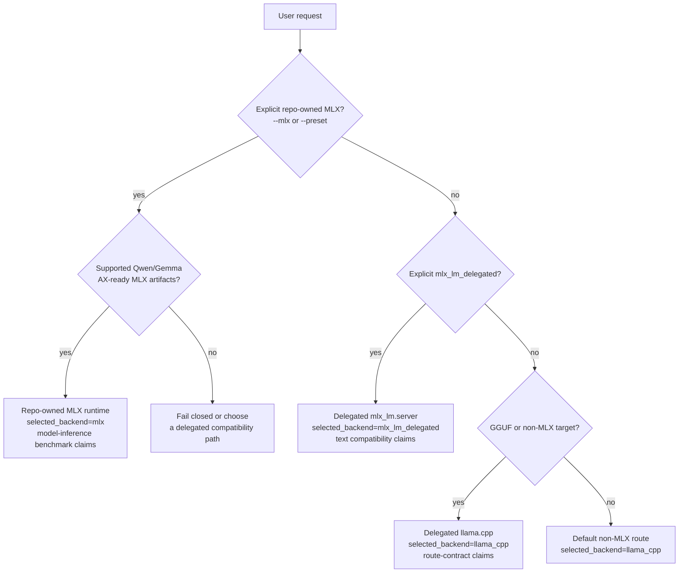

# Getting Started

AX Engine runs AI models locally on Apple Silicon with MLX. It includes a
native macOS app, an OpenAI-compatible server, SDKs, and benchmark tools.
M5 and later are the primary hardware tier. Mac mini M4 Pro 64 GB remains a
supported check host.

Qwen 3.8 27B and Flash Next target **MLX AXQ MXFP4 / MXFP8 with MTP**, and
Flash Next also supports **affine 6-bit MTP** as the quality/size balance point
(ADR-050). The 27B MXFP8 pack is a catalog Candidate. Flash Next MXFP8
admission is pending. Historical receipts apply to their recorded format.
See [format policy](QWEN38-FORMAT-POLICY.md).

The first-run CLI example uses `qwen3.8-27b:axq`, the pinned Qwen 3.8 27B
MXFP4 MTP pack. The historical MTP figures of **31.05 tok/s** and **76.90 tok/s**
apply to the retired affine 6-bit campaign from September 2026. MTP requires
explicit opt-in.

**Qwen 3.8 27B AXQ status:** Primary optimization target. Checkpoint Tier 1. MTP Tier 2 pending. AX certification record: Candidate (gates open).

Fleet orchestration and NVIDIA/CUDA worker integration are provided by the
separate [AX Serving](AX-SERVING.md) product.

**Related:** [Supported Models](SUPPORTED-MODELS.md) · [CLI](CLI.md) ·
[Server](SERVER.md) · [AX Serving](AX-SERVING.md) · [FAQ](FAQ.md) ·
[Docs hub](README.md)

## What You Get

- `ax-engine-server`: local HTTP server over the SDK runtime
- `ax-engine-bench`: workload-contract, readiness, direct-generate, and
  benchmark-support CLI
- `ax-engine-sdk`: backend resolution and session contract
- Python bindings, and JavaScript, Go, Ruby, Swift, and Mojo clients
- repo-owned MLX inference for supported Qwen, Gemma, GLM, and embedding model artifacts
- explicit delegated compatibility for `mlx_lm.server` and `llama.cpp`

## Choose A Runtime Path

| Path | Select it when | Notes |
|---|---|---|
| Repo-owned MLX runtime | You have a supported Qwen/Gemma MLX model artifact and want repo-owned runtime behavior or performance evidence | Use `--mlx` plus `--mlx-model-artifacts-dir`; benchmark claims must use the MLX inference-stack harness |
| `mlx_lm_delegated` | Upstream `mlx-lm` supports the MLX text model but AX does not yet have a repo-owned graph | Requires a running `mlx_lm.server`; supports blocking and SSE text generation plus OpenAI-compatible text completion/chat shapes; route-contract evidence only |
| `llama_cpp` | You have GGUF/non-MLX local inference needs | Use a llama.cpp server or CLI target; these are delegated route-contract claims |



The diagram is a routing guide, not a benchmark shortcut. Repo-owned MLX
performance claims still require the MLX inference-stack harness; delegated
paths validate compatibility and route behavior. NVIDIA/CUDA workers are
outside AX Engine; see [AX Serving](AX-SERVING.md).

## Installation

### Install the macOS app

The recommended end-user path installs **AX Engine.app and its bundled native
runtime** on Apple Silicon (M5 or later recommended; M3–M4 supported; M2 best-effort), macOS 26.2 or later. Quit AX Engine,
then run:

```bash
curl -fsSL https://download.automatosx.com/ax-engine-desktop/install | bash
```

Open AX Engine from Applications, download a suitable model from Models → Catalog,
and use the server controls or streaming chat. Homebrew, Python and Xcode are
not required; public model downloads do not require a Hugging Face account.
Models are downloaded separately and must fit the Mac's memory and disk.

Run the same command again to upgrade after quitting the app. Models, settings
and conversations are preserved. The installer verifies release signatures,
Apple identity and Gatekeeper, stages replacement and restores the previous app
on failure. In AX Engine 8.1.0 and later, use **AX Engine → Check for Updates…**
or enable scheduled checks in **Settings → General → App updates**. See the
[macOS update guide](MACOS-UPDATES.md).

Use `bash -s -- --verify-only` in place of `bash` to verify without installing,
or `bash -s -- --applications-dir "$HOME/Applications"` to use an existing
user-writable Applications directory. The app installer does not add global CLI
commands to PATH. See the [app guide](MACOS-APP.md) for usage.

### Advanced CLI and Python channels

Homebrew, the standalone download, and the Python wheel are available for
Apple Silicon. **Homebrew is optional.**

For Linux CUDA inference, use
[AX Engine for SGLang](https://github.com/defai-digital/ax-engine-sglang#quick-start).
For fleet deployments, see the commercial product [AX Serving](AX-SERVING.md).

| Goal | Recommended channel |
| --- | --- |
| Download models, chat, and control a local server from the desktop | [macOS app via curl](../README.md#install-ax-engine-for-macos) |
| Run the CLI, server, or benchmark tools, and you use Homebrew | Homebrew |
| Run the CLI and server without Homebrew or the Python SDK | Standalone download |
| Embed inference in Python with `import ax_engine` or use Python integrations | [Python wheel via pip](#python-wheel-sdk-no-homebrew-needed) |
| Connect to a running AX Engine server from any language | [OpenAI-compatible HTTP client](API-COMPATIBILITY.md) |
| Develop AX Engine or test unreleased changes | Source build |

Prebuilt packages need **Apple Silicon** (M5 or later recommended, M3–M4
supported, M2 best-effort) and **macOS 26.2 or later**:

```bash
uname -m                 # must print: arm64
sw_vers -productVersion  # must print 26.2 or higher
```

Homebrew is optional. Start from the [macOS app installation](../README.md#install-ax-engine-for-macos)
for the GUI with a bundled runtime. The CLI channels below do not install the GUI.

The repository can move ahead of its released packages. Refresh the selected
channel and compare it with the
[latest GitHub release](https://github.com/defai-digital/ax-engine/releases/latest)
before following the examples:

```bash
brew update
brew info defai-digital/tap/ax-engine
python3 -m pip index versions ax-engine   # optional: Python SDK channel
```

If one channel has not caught up with the latest release, use the other channel
or build that tagged release from source. Do not silently continue with an
older package: it may not provide the command surface documented here.

### Homebrew

Install the signed macOS arm64 CLI, server, and bench binaries:

```bash
brew install defai-digital/tap/ax-engine
ax-engine doctor
```

That installs `ax-engine`, `ax-engine-server`, `ax-engine-bench`, and the model
helper scripts onto your `PATH`.

> [!NOTE]
> The formula bundles the pinned, precompiled MLX runtime. AX Engine 8.1.0
> and later download public Hugging Face models and resolve public aliases
> natively, without Python, Xcode, or the Metal Toolchain.

#### Model download helpers

Current Homebrew and standalone builds share the native downloader:

```bash
ax-engine download qwen3.8-27b:axq
ax-engine serve qwen3.8-27b:axq --offline
```

The native CLI accepts a public alias, public Hugging Face repository or
local directory. For a gated or private model, acquire the artifacts with a
client authenticated to that repository and pass the local directory to
`ax-engine serve`. See [CLI download behavior](CLI.md#ax-engine).

Commands that prepare MTP sidecars, such as `download-mtp` and
`convert-mtplx`, still use Python. To use those helpers from a native CLI,
point `AX_ENGINE_PYTHON` at a Python environment with the download
dependencies installed:

```bash
python3.13 -m venv "$HOME/.local/share/ax-engine/download-env"
"$HOME/.local/share/ax-engine/download-env/bin/python" -m pip install \
  "ax-engine[download]>=8.1.0,<9"
export AX_ENGINE_PYTHON="$HOME/.local/share/ax-engine/download-env/bin/python"
```

#### Homebrew troubleshooting

Artifacts produced by the self-contained release pipeline bundle the pinned
MLX runtime and precompiled `mlx.metallib`. Homebrew users do not need Xcode,
Python MLX, or the Metal Toolchain. Verify the installed layout and executable
startup with:

```bash
brew reinstall defai-digital/tap/ax-engine
brew test defai-digital/tap/ax-engine
ls "$(brew --prefix ax-engine)/libexec/libmlx.dylib"
ls "$(brew --prefix ax-engine)/libexec/mlx.metallib"
```

The `steipete/tap` trust warning sometimes shown by Homebrew is unrelated to
AX Engine.

**Linkage model:** GitHub release binaries are built against the pinned pip MLX
for source/wheel performance parity. The standalone tarball bundles
`libmlx.dylib`, `libjaccl.dylib`, and `mlx.metallib`; it contains no
builder-host rpath. Homebrew installs those same signed bytes under its
`bin/` and private `libexec/` layout without modifying Mach-O load commands.

```bash
ax-engine doctor
ax-engine-server --help
ax-engine-bench doctor
```

If `ax-engine-bench` / `ax-engine doctor` fails with
`Library not loaded: @rpath/libmlx.dylib`, the formula or archive predates the
self-contained runtime contract. Update the tap and reinstall:

```bash
brew update
brew reinstall defai-digital/tap/ax-engine
brew test defai-digital/tap/ax-engine
```

#### Gatekeeper warning on older releases

AX Engine release binaries for `6.7.1` and newer are expected to be Developer ID
signed and notarized. The canonical `scripts/publish-github-release.sh` now
requires Developer ID signing and notarization before it can publish. Older
release archives were ad-hoc signed and may still show a Gatekeeper dialog that
says _"cannot be opened because Apple cannot verify it"_. That does **not** mean
the binaries are malicious.

For older ad-hoc signed archives, use one of these one-time workarounds.

**Option A — System Settings (per binary):**

1. Try to run the binary once (e.g. `ax-engine-server --help`). The dialog appears.
2. Open **System Settings → Privacy & Security**.
3. Scroll down to the Security section. You will see an _"ax-engine-server was
   blocked"_ entry with an **Allow Anyway** button.
4. Click **Allow Anyway**, then run the command again and click **Open** in the
   confirmation dialog.
5. Repeat for `ax-engine-bench` if needed.

**Option B — Terminal (clears the quarantine flag):**

```text
sudo xattr -dr com.apple.quarantine "$(which ax-engine-server)"
sudo xattr -dr com.apple.quarantine "$(which ax-engine-bench)"
```

Run this once after `brew install`. No Apple Developer account is required.

### Standalone download (no Homebrew)

Each GitHub release ships a signed and notarized `arm64` tarball containing
`ax-engine`, `ax-engine-server`, `ax-engine-bench`, the pinned MLX runtime
(`libmlx.dylib`, `libjaccl.dylib`, `mlx.metallib`), and the model helper
scripts. It needs no Python, Xcode, or Metal Toolchain to serve a ready local
model directory. Downloading with `curl` avoids the browser quarantine prompt:

```bash
TAG=$(curl -fsSLI -o /dev/null -w '%{url_effective}' \
  https://github.com/defai-digital/ax-engine/releases/latest | sed 's|.*/||')
ASSET="ax-engine-$TAG-macos-arm64.tar.gz"
BASE="https://github.com/defai-digital/ax-engine/releases/download/$TAG"
cd "$(mktemp -d)"
curl -fsSLO "$BASE/$ASSET" && curl -fsSLO "$BASE/$ASSET.sha256"
shasum -a 256 -c "$ASSET.sha256"          # must print: OK
mkdir -p "$HOME/.local/ax-engine" && tar -xzf "$ASSET" -C "$HOME/.local/ax-engine"
echo 'export PATH="$HOME/.local/ax-engine:$PATH"' >> ~/.zprofile
export PATH="$HOME/.local/ax-engine:$PATH"
ax-engine doctor
```

Keep the binaries and the three runtime files in the same directory. To
upgrade, repeat the commands. The standalone archive includes the native
public-model downloader. See [Minisign verification](MINISIGN.md) for the
detached signatures.

### Python wheel (SDK, no Homebrew needed)

Use the [PyPI wheel](https://pypi.org/project/ax-engine/) to run inference inside
a Python process with `import ax_engine`, use integrations such as LangChain,
or manage the bundled CLI and server alongside Python automation. A dedicated
Python 3.12+ virtual environment lets your project pin the SDK and runtime
together. See the [Python SDK](sdk/python.md) for in-process examples.

If your application calls an existing AX Engine server, use its
[OpenAI-compatible HTTP API](API-COMPATIBILITY.md) with your usual client.

Without `uv` or Homebrew, use the official Python macOS installer:

1. Download the **Python 3.13** macOS installer (any 3.13.x) from
   [python.org](https://www.python.org/downloads/macos/) and run it.
2. Quit and reopen Terminal, then check `python3.13 --version`. Use
   `python3.13` explicitly, not `python3`.
3. Create a new environment and install AX Engine:

```bash
python3.13 -m venv "$HOME/.venvs/ax-engine"
source "$HOME/.venvs/ax-engine/bin/activate"
python -m pip install --upgrade pip
python -m pip install --upgrade "ax-engine>=8.1.0,<9"
ax-engine doctor
```

4. So that `ax-engine` is found in every new Terminal without activating the
   environment, add it to your `PATH`:

```bash
echo 'export PATH="$HOME/.venvs/ax-engine/bin:$PATH"' >> ~/.zprofile
```

If you already use `uv`, it can create the environment with an explicit
Python version instead:

```bash
uv venv --python 3.12 .venv
source .venv/bin/activate
uv pip install --upgrade "ax-engine>=8.1.0,<9"
python -c 'import importlib.metadata; print(importlib.metadata.version("ax-engine"))'
which -a ax-engine
ax-engine doctor
```

The current macOS arm64 wheel exposes `ax-engine` and `ax-engine-server` and
bundles `ax-engine-bench` behind the Python entrypoints, so a wheel-only install
can still serve and diagnose. If pip cannot find a matching release for your
platform, first check the interpreter and platform requirements in
[Python installation troubleshooting](#python-installation-troubleshooting),
then confirm that your configured package index is current. The wheel
bundles AX and MLX Metal runtime assets used by normal serving; Xcode and
Apple's Metal Toolchain are only required when you build from source, run
developer diagnostics, or rebuild AX Metal kernels.

The wheel and Homebrew formula both install commands named `ax-engine` and
`ax-engine-server`. If you install both, an active virtual environment normally
shadows `/opt/homebrew/bin`; check `which -a ax-engine` and use one installation
channel in each shell to avoid running mismatched versions.

#### Python installation troubleshooting

The wheel requires **Python 3.12+**, macOS 26.2 or later, and Apple Silicon
(M5 or later recommended, M3–M4 supported, M2 best-effort).
A generic `python3` command may select an older interpreter, including Python
3.9.6. Check the interpreter in the active environment:

```bash
python --version
python -m pip --version
```

If pip reports `No matching distribution found` or ignores releases requiring
another Python version, check these requirements before retrying. Upgrading
pip does not upgrade Python, and an existing virtual environment keeps the
interpreter version used to create it. A subsequent `ax-engine: command not
found` can mean the package was never installed successfully.

Common failures and their fixes:

| Symptom | Cause | Fix |
| --- | --- | --- |
| `No matching distribution found for ax-engine` | Python older than 3.12, or macOS older than 26 | Check `python --version` and `sw_vers -productVersion`. Recreate the environment with Python 3.13 below. |
| pip accepts the wheel on macOS 26.0 or 26.1 | The `macosx_26_0_arm64` wheel tag uses the major macOS version. The bundled AX Engine binaries require 26.2. | Update macOS to 26.2 or later. |
| Dependency resolution fails with the `download` extra | A dependency lacks a compatible wheel or version for the environment | Install the base `ax-engine` wheel for in-process inference, or use a fresh Python 3.13 environment for the Python download helpers |
| `ax-engine: command not found` in a new Terminal | The virtual environment is not active and not on `PATH` | `source "$HOME/.venvs/ax-engine/bin/activate"`, or add `$HOME/.venvs/ax-engine/bin` to `PATH` |
| `python3.13: command not found` after the installer | Terminal opened before the install | Quit and reopen Terminal, or call `/Library/Frameworks/Python.framework/Versions/3.13/bin/python3.13` |
| `xcode-select: note: No developer tools were found` prompt | Bare `python3`/`git` ran without Xcode Command Line Tools | Cancel it and use `python3.13` from python.org; AX Engine itself does not need Xcode |
| `Repository Not Found` / `401` while downloading a model | The snapshot is not publicly downloadable | Choose a public snapshot from the [AutomatosX collection](https://huggingface.co/AutomatosX/models?sort=alphabetical); `qwen3.8-27b:axq` is public |

To recover from an older virtual environment, deactivate it and create a
separate Python 3.13 environment, preserving the original environment. Install
Python 3.13 from python.org first; Homebrew is not required:

```bash
deactivate  # Run only if a virtual environment is active.
python3.13 -m venv "$HOME/.venvs/ax-engine-py313"
source "$HOME/.venvs/ax-engine-py313/bin/activate"
python --version
python -m pip install --upgrade pip
python -m pip install --upgrade "ax-engine>=8.1.0,<9"
ax-engine doctor
```

If `python3.13` is not on your `PATH` after the official installer finishes,
reopen Terminal or use
`/Library/Frameworks/Python.framework/Versions/3.13/bin/python3.13` to create
the environment. If you already have Homebrew, `brew install python@3.13` is
an optional alternative to the official installer.

### Source

Use source builds for development, local examples, or changes that have not
been tagged yet. Install Python 3.13 as described in the wheel setup above.
Source is the advanced fallback when neither Homebrew nor pip has the current
tagged release. Install Xcode first, open it once to finish
Apple's setup prompts, then install the Metal Toolchain component:

```text
brew install protobuf
xcodebuild -downloadComponent metalToolchain
python3.13 -m venv .venv
source .venv/bin/activate
python -m pip install --upgrade pip maturin
python -m pip install "mlx==$(cat mlx.version)"
# Server needs release-server (panic=unwind) so worker panic containment works.
# See docs/SERVER.md and Cargo.toml [profile.release-server].
bash scripts/cargo-pinned.sh build --profile release-server -p ax-engine-server
bash scripts/cargo-pinned.sh build --release -p ax-engine-bench
# Python extension: use release-pyext (unwind), not --release (abort).
maturin develop --profile release-pyext
export PATH="$PWD/target/release-server:$PWD/target/release:$PATH"
ax-engine doctor
bash scripts/check-mlx-version.sh
```

The Cargo wrapper reads `rust-toolchain.toml` and selects the matching Cargo,
compiler, rustdoc, and Cargo subcommands. This prevents an unrelated Rust
installation earlier on `PATH` from changing child-tool selection. Use the
wrapper for `test`, `fmt`, and `clippy` as well. Wheel builds select the same
toolchain automatically.

The repo pins the admitted MLX version in `mlx.version` at the repo root, and
`crates/mlx-sys/build.rs` enforces it at link time: builds fail loudly if the
resolved MLX is a different version (`AX_MLX_VERSION_OVERRIDE=1` to
experiment) or the Homebrew formula (`AX_MLX_ALLOW_HOMEBREW=1` for bring-up
only). The build also consults the repo-local `.venv` even when it is not
activated, so a bare `cargo build` on a dev machine cannot silently drift to
another MLX install. `scripts/check-mlx-version.sh` verifies the same
contract without compiling: pinned version, wheel-bundled `libmlx.dylib`, and
non-Homebrew provenance. It reports `LC_BUILD_VERSION` for diagnosis, but does
not use `minos` as a NAX proxy: the admitted PyPI MLX 0.32.3 wheel reports
`minos 26.2`; older admitted wheels reported lower deployment targets while
still containing certified kernels. Bumping the pin is deliberate: update
`mlx.version`, rerun the qmm microbench parity gate and the bit-exactness
suites, and only then trust results.

> [!IMPORTANT]
> Install `mlx` with `pip`, not `brew install mlx`. Homebrew's `mlx` formula
> is not the admitted, byte-identical runtime used for AX Engine's release and
> performance qualification. Some Homebrew builds have also shown materially
> different Metal backend performance. `minos` alone does not establish which
> kernels are present, so the build and release gates use pinned version,
> wheel provenance, exact asset digests, and runtime tests instead.
> `crates/mlx-sys/build.rs` prefers a pip-installed `mlx` when both are
> present; install it into the active venv before `cargo build`. See
> `scripts/build-pypi-wheel.sh`'s header comment for the full investigation.

Run the Python test slice from the same environment with:

```text
python -m pip install pytest
python -m pytest python/tests
```

## Repository Areas

- `crates/ax-engine-core`: core runtime contracts and bring-up execution loop
- `crates/ax-engine-mlx`: MLX model graphs, KV cache, n-gram acceleration, DFlash2 block drafting, MTP, the M5 NAX attention policy, and runner dispatch
- `crates/mlx-sys`: bindgen FFI over `ax_shim.h` to MLX C++; safe `MlxArray` RAII wrappers
- `crates/ax-engine-bench`: workload-contract CLI and bring-up runtime harness
- `crates/ax-engine-microbench`: isolated microbenchmarks and kernel dispatch probes
- `crates/ax-engine-sdk`: SDK facade with backend resolution and session management
- `crates/ax-engine-server`: local HTTP server adapter over the SDK
- `sdk/javascript/`: repo-local JavaScript client package
- `sdk/swift/`: native Swift async/await client package
- `crates/ax-engine-py`: Python extension crate (PyO3)
- `benchmarks/`: canonical benchmark manifests
- `python/`: Python package wrapper, type stubs, tests, examples
- `scripts/`: E2E smoke check scripts
- `docs/`: public-facing documentation

For the current crate layering and dependency-boundary guidance, see
[Architecture](ARCHITECTURE.md).

## Requirements

- macOS 26 (Tahoe) or later for runtime admission. Prebuilt app, Homebrew,
  wheel, and standalone binaries require **macOS 26.2 or later**
- Apple Silicon: **M5 or later** is the primary target; M3–M4 are supported;
  M2 is best-effort (it runs, and it is not tuned or qualified)
  - **Light host (16 GB):** base Mac mini M4 and similar — one compact Qwen
    3.5 9B pack (4-bit preferred; 6-bit works with less free RAM), short
    context only
  - **Full local server (32 GB+):** multi-model serving, longer contexts, and
    larger packs (27B/35B class). **Mac mini M4 Pro 64 GB** is the supported
    27B check. **MacBook Pro M5 Max 128 GB** is the primary 27B host and the
    Flash Next qualification standard
- Rust pinned by `rust-toolchain.toml` (**1.99.1**) for source builds.
  `Cargo.toml` records 1.88 as the minimum language version. Use the pin so
  another Rust install earlier on `PATH` does not replace it
- `mlx` for source-built MLX runtime binaries, at the version in `mlx.version`
  (currently 0.32.4)
- a running `mlx_lm.server` for `mlx_lm_delegated`
- a llama.cpp server or CLI target for `llama_cpp`

Published performance is measured on M5-class Macs. Correctness coverage
includes M3–M4, and M2 results are signal only. A base Mac mini M4 with 16 GB
is a light single-model host. Multi-model and large-pack evidence still comes
from **32 GB+** hosts. Flash Next qualification stays on MacBook Pro M5 Max
128 GB.

Runtime surfaces fail closed when a backend is unavailable instead of silently
pretending support exists.

Wired-memory control is available on supported M2-or-newer Macs, including
base, Pro, Max and Ultra variants; it does not require M5. The current automatic
Tiel **no-wire** optimization is narrower: audited export metadata, M5 Max,
at least 128 GiB, no expert streaming and no numeric operator override.
Other hosts retain the existing wiring policy. This tuning guard does not
reject otherwise supported models or hosts. Model memory requirements still
apply. See [Tiel residency policy and overrides](mtp/tiel-prefill-diagnostics.md#residency-policy-for-the-audited-m5-max-exports).

## Getting a Model

AX Engine loads safetensors for supported architectures using a
`model-manifest.json`. Public AutomatosX packs can include prepared MTP
sidecars or assistant weights. Public community checkpoints can be fetched
by exact `org/repo` ID. The runtime validates the model layout on load.
See [Supported Models](SUPPORTED-MODELS.md) and the
[live AutomatosX catalog](https://huggingface.co/AutomatosX/models).

### Path A — GUI or CLI

Use [AX Engine for macOS](MACOS-APP.md) for graphical operation. The TUI has
been retired. The CLI remains available for scripts and local model paths.

```text
ax-engine download --list              # list managed aliases
ax-engine serve qwen3.8-27b:axq --port 31418
# Require the pinned Qwen 3.8 27B AXQ MXFP4 MTP cache
ax-engine serve qwen3.8-27b:axq --offline --port 31418
# Compact community model for lower-memory Macs
ax-engine serve qwen3.5-9b --port 31418
# Embedding sibling for /v1/embeddings
ax-engine download mlx-community/embeddinggemma-300m-8bit
```

`qwen3.8-27b:axq` is the unique general-purpose default. Record:
[Qwen 3.8 27B AXQ certification](model-certifications/qwen3.8-27b-axq.md).
`qwen3.6-27b:axq` remains an explicit secondary AXQ candidate;
[its certification gates](model-certifications/qwen3.6-27b-axq.md) are still
open and its 8-hour soak is 3.6 evidence, not 3.8.

To keep a second allowlisted model resident, use `POST /v1/model/load` with
`load_mode=add` and `make_default=false`. The pinned Qwen 3.8 27B MXFP4
pack can remain the chat default while Qwen3-Embedding 0.6B serves embeddings
from the same process. [Supported models and example](SERVER.md#multi-model-serving).

Use the pinned MXFP4 alias for the Flash Next Candidate on a MacBook Pro
M5 Max 128 GB.

```sh
ax-engine serve qwen3.8-flash-next:axq
```

The current source defaults to one resident active request, a 32,768-token
combined prompt and output budget, and direct decoding. On the verified
internal startup SSD, the loader automatically selects aligned buffered reads
for the published MXFP4 layout. The signed benchmark measures HTTP readiness
from process start after the pack is available locally.
[Flash Next profile and evidence](model-certifications/qwen3.8-flash-next.md#current-mxfp4-evidence).

### Path B — Python API

`download_model()` downloads weights through `huggingface-hub`, resolves the cache
snapshot, and auto-generates the manifest:

```python
from ax_engine import download_model
path = download_model("mlx-community/Qwen3-4B-4bit")
# Session is ready once this returns
```

Install with
`python -m pip install --upgrade "ax-engine[download]>=8.1.0,<9"`.

Or via the script:

```text
python scripts/download_model.py mlx-community/Qwen3-4B-4bit
python scripts/download_model.py mlx-community/Qwen3-4B-4bit --json
```

Models land in the Hugging Face Hub cache shared with `mlx-lm`.
The downloader accepts public embedding repositories as well. To verify that
a specific model is available, check the repository and revision before
downloading.

### Path C — raw Hugging Face checkpoint

For a supported raw checkpoint already on disk, generate its manifest and
serve the directory. AX Engine applies the supported Hugging Face weight
transforms at load time:

```text
ax-engine-bench generate-manifest /path/to/model
ax-engine serve /path/to/model --offline
```

Use a consistent source layout throughout the directory. A partially converted
checkpoint can fail validation.

### Manifest generation

Direct MLX models use a `model-manifest.json`. The native CLI generates it as
needed. The Python download helpers use a bundled or installed
`ax-engine-bench`, or Cargo in a source checkout. To run it manually:

```text
ax-engine-bench generate-manifest /path/to/model     # installed
bash scripts/cargo-pinned.sh run -p ax-engine-core --bin generate-manifest -- /path/to/model  # from source
```

## First Commands

Homebrew installs put `ax-engine-bench` on your `PATH`. If you are working from
source, replace `ax-engine-bench` with
`cargo run -p ax-engine-bench --bin ax-engine-bench --`.

To inspect the workload-contract CLI:

```text
ax-engine-bench help
```

To inspect whether the local machine is inside the supported M2-or-newer AX
runtime contract:

```text
ax-engine-bench doctor
```

To run one thin direct inference request through the SDK-owned session surface:

```text
ax-engine-bench generate --tokens 1,2,3 --max-output-tokens 4
```

To run a llama.cpp-backed text request through a delegated server:

```text
ax-engine-bench generate \
  --prompt "Hello from AX" \
  --support-tier llama_cpp \
  --llama-server-url http://127.0.0.1:8081
```

To run an MLX text model through upstream `mlx-lm` while keeping AX Engine
server/SDK/CLI surfaces:

```text
mlx_lm.server --model /absolute/path/to/mlx-model --host 127.0.0.1 --port 8090

ax-engine-bench generate \
  --prompt "Hello from mlx-lm" \
  --support-tier mlx_lm_delegated \
  --mlx-lm-server-url http://127.0.0.1:8090
```

That route is explicit compatibility only. It is text-only, supports AX
blocking and SSE text surfaces, and is not a repo-owned MLX performance claim.
Streamed chunks are delegated text deltas, not AX-owned token/KV evidence.

For NVIDIA/CUDA fleet deployments, see [AX Serving](AX-SERVING.md).
The [migration notes](AX-SERVING.md#migration) cover the former AX Engine CUDA
support tiers and provider-specific flags.

To run a checked-in scenario manifest through the current workload-contract
path:

```text
ax-engine-bench scenario --manifest benchmarks/manifests/scenario/chat_qwen_short.json --output-root benchmarks/results
```

The checked-in delegated llama.cpp manifests are route-contract examples, not
repo-owned model-inference benchmarks. They validate the stepwise
`llama.cpp /completion` delegation path and backend-reported prompt-cache
evidence.

To compare the repo-owned MLX runtime against the upstream MLX-family inference
standard:

```text
python3 scripts/bench_mlx_inference_stack.py \
  --model-dir /path/to/local/mlx-model \
  --prompt-tokens 512,2048 \
  --generation-tokens 128 \
  --repetitions 5 \
  --cooldown 15
```

That harness requires `mlx_lm.benchmark` as the primary reference and fails
closed if the matching baseline cannot be produced. Add `--ax-compare-policies`
when you need both direct and n-gram acceleration repo-owned MLX rows. The
AX server/user default is n-gram acceleration, while the direct AX row is
kept as the same-policy comparison baseline. N-gram rows are
effective-throughput evidence. Each AX
or optional `mlx-swift-lm` row is compared against the matching
`mlx_lm.benchmark` random-token prompt/decode shape. Use
`--mlx-swift-lm-command` only for an explicit `BenchmarkHelpers` /
`MLXLMCommon` generation adapter that reads the harness-emitted prompt token
JSON. Do not use the retired SwiftLM application-server benchmark as a current
AX Engine baseline.

To validate checked-in MLX dense Qwen and Gemma scenario manifests
through one repo-owned smoke command:

```text
bash scripts/check-bench-mlx.sh
```

That smoke path now emits the repo-owned Metal build report into the default
`build/metal` directory, or the explicit `AX_ENGINE_METAL_BUILD_DIR` override
if set, and when that report reaches `status=compiled` it also requires
benchmark-visible `metal_dispatch_completed` evidence instead of silently
accepting a CPU-only fallback.

To validate the checked-in readiness-report contract itself:

```text
bash scripts/check-bench-doctor.sh
```

To emit the checked-in Phase 1 Metal kernel build report and compile the
compiled Metal preview artifacts (`.air`, `.metalar`, and `.metallib`) when the
local toolchain is actually ready:

```text
cargo run -p ax-engine-bench --bin ax-engine-bench -- metal-build
bash scripts/build-metal-kernels.sh
```

The repo-owned `ax-engine-bench metal-build` subcommand is now the canonical build
entrypoint. `scripts/build-metal-kernels.sh` remains as a thin wrapper over
that Rust-owned path for smoke checks and automation.
When the same output directory already holds validated compiled assets for the
current checked-in contract, that build command now reuses them instead of
rerunning the full toolchain pipeline.
That checked-in build graph uses `xcrun metal` and `xcrun metallib` as the
required compiler tools. When `metal-ar` is available, AX keeps the archive
stage in the generated artifact report; when only Command Line Tools are
installed, the builder compiles the `.metallib` directly from the `.air` file.
The current MLX Metal bring-up contract stays intentionally narrow by
validating only `block_size_tokens=16`.

To validate the checked-in Metal kernel inventory, manifest, and gated build
contract in one repo-owned smoke check:

```text
bash scripts/check-metal-kernel-contract.sh
```

When a compiled Phase 1 `metallib` is later loaded through the core-owned
macOS bring-up path, AX also treats a sibling
`ax_phase1_dense_path.binary_archive.metallib` as a best-effort pipeline cache:
valid archives are reused, stale ones are recreated, and required compute
pipeline descriptors are serialized back out without turning cache misses into
hard runtime failures.

That bring-up path also now keeps one process-local Metal dispatch arena for
KV cache buffers, so repeated dispatches can reuse previously materialized
slot-backed cache storage while refreshing only the per-step metadata/input
buffers that describe the current workload.

To validate the checked-in MLX replay manifests for live-share, retained
reuse, mixed-path, full-prefix decode, and memory-blocked recovery behavior:

```text
bash scripts/check-bench-replay.sh
```

To run the repo-owned llama.cpp delegated-contract smoke path for the
checked-in scenario and replay example manifests:

```text
bash scripts/check-bench-preview.sh
```

To start the preview local server:

```text
cargo run -p ax-engine-server -- --model-id qwen3_dense --mlx --mlx-model-artifacts-dir /absolute/path/to/mlx-model-artifacts --port 31418
```

To install the checked-in JavaScript client from this repository:

```text
npm install ./sdk/javascript
```

That package is intentionally thin: it targets the preview server's
`/v1/runtime`, `/v1/generate`, `/v1/generate/stream`, `/v1/completions`,
`/v1/chat/completions`, and `/v1/embeddings` endpoints rather than bypassing
the SDK/server contract. See [API Compatibility](API-COMPATIBILITY.md) before assuming full
OpenAI API parity.

To run a repo-owned end-to-end server smoke check instead of driving that path
manually:

```text
bash scripts/check-server-preview.sh
```

To query runtime metadata from that server:

```text
curl http://127.0.0.1:31418/v1/runtime
```

That runtime payload now includes backend-resolution metadata plus host and
Metal-toolchain diagnostics.

To submit and inspect a request through the shared preview server session:

```text
curl http://127.0.0.1:31418/v1/requests -H 'content-type: application/json' -d '{"model":"qwen3_dense","input_tokens":[1,2,3],"max_output_tokens":2}'
curl -X POST http://127.0.0.1:31418/v1/step
curl http://127.0.0.1:31418/v1/requests/1
```

To stream preview lifecycle events from the local server:

```text
curl -N http://127.0.0.1:31418/v1/generate/stream -H 'content-type: application/json' -d '{"model":"qwen3_dense","input_tokens":[1,2,3],"max_output_tokens":2}'
```

To compile the current workspace:

```text
cargo check
```

To build and install the preview Python package into the active environment:

```text
maturin develop
```

If you want one repo-owned command that bootstraps a temporary virtualenv,
installs `maturin`, builds the extension, runs the checked-in Python examples,
and then runs both the installed-package preview tests and the wrapper tests,
use:

```text
bash scripts/check-python-preview.sh
```

To run the checked-in Python preview examples after installation:

```text
python examples/python/basic.py
python examples/python/stepwise.py
python examples/python/streaming.py
```

See `docs/sdk/python.md` for the current Python preview scope.

## Stability Note

Public command surfaces and runtime behavior are still evolving.
Expect interface changes while the v6 engine loop, KV manager, sampler
boundary, and benchmark system continue to mature.
